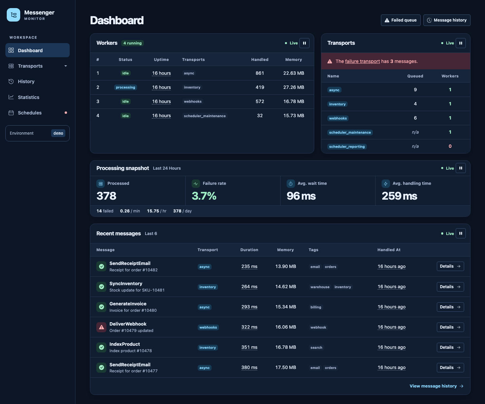
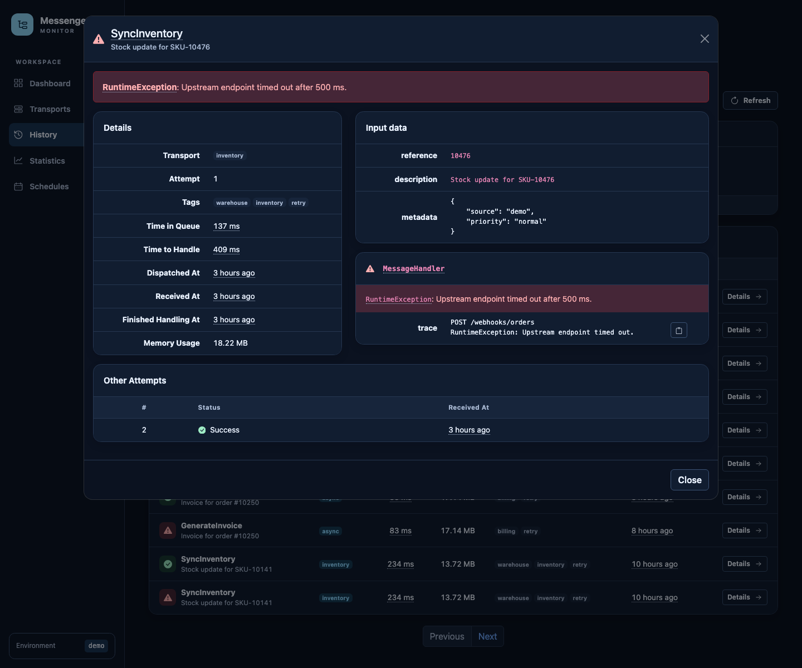
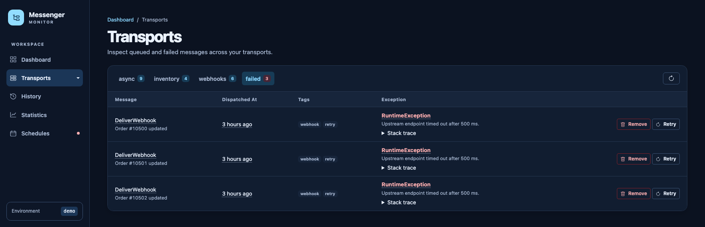
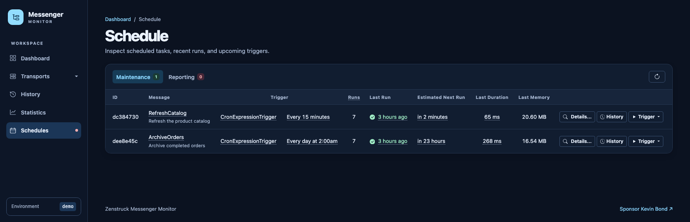

# zenstruck/messenger-monitor-bundle

[](https://github.com/zenstruck/messenger-monitor-bundle/actions/workflows/ci.yml)
[](https://codecov.io/gh/zenstruck/messenger-monitor-bundle)

Batteries included UI to monitor your Messenger workers, transports, schedules, and messages.

| Dashboard | Message details |
| :---: | :---: |
| [](docs/images/dashboard.png) | [](docs/images/message-details.png) |
| **Failed transport** | **Schedules** |
| [](docs/images/failed-transport.png) | [](docs/images/schedules.png) |

If the packaged UI is not to your liking, you can easily build your own with the
[provided tools](#advanced-usage).

- [Installation](#installation)
- [Console monitor](#messengermonitor-command)
- [Storage and message history](#storage)
- [User interface](#user-interface)
- [Advanced usage](#advanced-usage)
- [Configuration reference](#full-default-bundle-configuration)

## Installation

Requires PHP 8.1+ and Symfony 6.4 (6.4.1+), 7.x, or 8.x, with the PHP version required by your Symfony release.

```bash
composer require zenstruck/messenger-monitor-bundle
```

Symfony Flex registers the bundle automatically. Without Flex, add it to `config/bundles.php`:

```php
return [
    // ...
    Zenstruck\Messenger\Monitor\ZenstruckMessengerMonitorBundle::class => ['all' => true],
];
```

Worker and transport monitoring work immediately. Configure [storage](#storage) for message
history and the [user interface](#user-interface). See [UPGRADE.md](UPGRADE.md) when upgrading.

## `messenger:monitor` Command

With zero configuration, you can run the `messenger:monitor` command to see information
about your running workers and transports. If storage is configured, it displays a
historical snapshot whose period can be customized with the `--period` option.

```bash
bin/console messenger:monitor
bin/console messenger:monitor --no-interaction # print once instead of refreshing every second
bin/console messenger:monitor --period in-last-week # requires storage
```

The default history period is `in-last-day`. Use `in-last-hour`, `in-last-day`, `in-last-week`,
`in-last-month`, `today`, `yesterday`, `last-week`, `last-month`, or `all`.
Workers and the command must use the same [cache pool](#worker-cache).

## Storage

> [!NOTE]
> The [User Interface](#user-interface) and [History](#history) require storage.
> Doctrine ORM is the supported storage engine.

### Configuration

Install Doctrine ORM and migration tools if your app does not already have them:

```bash
composer require symfony/orm-pack
```

Configure your database connection before continuing.

1. Create a `ProcessedMessage` entity that extends `Zenstruck\Messenger\Monitor\History\Model\ProcessedMessage`
   in your app:
    ```php
    // src/Entity/ProcessedMessage.php

    namespace App\Entity;

    use Zenstruck\Messenger\Monitor\History\Model\ProcessedMessage as BaseProcessedMessage;
    use Doctrine\ORM\Mapping as ORM;

    #[ORM\Entity(readOnly: true)]
    #[ORM\Table('processed_messages')]
    class ProcessedMessage extends BaseProcessedMessage
    {
        #[ORM\Id]
        #[ORM\GeneratedValue]
        #[ORM\Column]
        private ?int $id = null;

        public function id(): ?int
        {
            return $this->id;
        }
    }
    ```

2. Add the entity class to the bundle config:
    ```yaml
    # config/packages/zenstruck_messenger_monitor.yaml

    zenstruck_messenger_monitor:
        storage:
            orm:
                entity_class: App\Entity\ProcessedMessage
                # entity_manager: custom
    ```

    If you use a different entity manager, set `entity_manager` next to `entity_class`.
    If you already set the `zenstruck_messenger_monitor.history.orm_manager` container parameter,
    it takes precedence over the bundle option.

3. Clear Cache:
    ```bash
    bin/console cache:clear
    ```

4. Create and execute the migration:
    ```bash
    bin/console doctrine:migrations:diff
    bin/console doctrine:migrations:migrate
    ```

5. Restart your Messenger workers so they load the new configuration:
    ```bash
    bin/console messenger:stop-workers
    ```
    Your process manager should start replacement workers. Start `messenger:consume` again
    yourself if you run workers manually.

> [!TIP]
> For large message histories, index `finished_at` for pagination and time-based snapshots.
> Index `run_id` to speed up retry lookups on the message details page. Add the relevant
> attributes to your `ProcessedMessage` entity, then generate and run a migration.
>
> ```php
> #[ORM\Index(name: 'idx_processed_messages_finished_at', fields: ['finishedAt'])]
> #[ORM\Index(name: 'idx_processed_messages_run_id', fields: ['runId'])]
> ```

### Usage

Once configured, messages dispatched to a transport and consumed by a Messenger worker are
tracked. Each completed attempt produces a history entry, including failed attempts that
Messenger will retry. Synchronous handling outside a worker is not recorded.

History includes the message class, description, tags, transport, timestamps, wait and handling
times, memory usage, handler results, and failures. View it in the [user interface](#user-interface)
or query it with the [history tools](#history).

If result normalization or history storage fails, the history entry is skipped and an error is logged
when a logger is available. Messenger continues acknowledging or retrying the message according to
its handler outcome.

> [!NOTE]
> Messages sent through Symfony 8.2's [`messenger.transport.interop_serializer`](https://symfony.com/doc/8.2/messenger.html#exchanging-messages-with-other-applications) are not recorded in history by default because it strips `MonitorStamp` on the initial send.
> The bundle does not currently provide a [stamp header mapper](https://symfony.com/doc/8.2/messenger.html#sharing-stamps-with-other-applications) to preserve monitoring metadata.

#### Disable Monitoring

You may want to disable monitoring for certain messages. There are several ways to do this:

1. When dispatching the message, add the `DisableMonitoringStamp`:
    ```php
    use Zenstruck\Messenger\Monitor\Stamp\DisableMonitoringStamp;

    /** @var \Symfony\Component\Messenger\MessageBusInterface $bus */

    $bus->dispatch(new MyMessage(), [new DisableMonitoringStamp()]);
    ```
2. Add the `DisableMonitoringStamp` as a class attribute to your message (or parent class/interface):
    ```php
    use Zenstruck\Messenger\Monitor\Stamp\DisableMonitoringStamp;

    #[DisableMonitoringStamp]
    class MyMessage
    {
    }
    ```
    You may want to disable monitoring for messages that are dispatched without any handler.
    You can do this by using the `DisableMonitoringStamp` with optional constructor argument `true`:
    ```php
    use Zenstruck\Messenger\Monitor\Stamp\DisableMonitoringStamp;

    #[DisableMonitoringStamp(onlyWhenNoHandler: true)]
    class MyMessage
    {
    }
    ```
3. Add the message class to the `exclude` config option (can be abstract/interface):
    ```yaml
    # config/packages/zenstruck_messenger_monitor.yaml

    zenstruck_messenger_monitor:
        storage:
            exclude:
                - App\Message\MyMessage
    ```
4. Set `auto_stamp: false` to stop adding `MonitorStamp` when dispatching messages. This lets
   applications without the bundle consume messages that would otherwise carry this stamp.
    ```yaml
    # config/packages/zenstruck_messenger_monitor.yaml

    zenstruck_messenger_monitor:
        storage:
            auto_stamp: false
    ```
    Add `MonitorStamp` when dispatching a message you want to monitor:
    ```php
    use Zenstruck\Messenger\Monitor\Stamp\MonitorStamp;

    /** @var \Symfony\Component\Messenger\MessageBusInterface $bus */

    $bus->dispatch(new MyMessage(), [new MonitorStamp()]);
    ```
    Symfony Scheduler messages are still stamped when the worker receives them.

#### Store Message Input

Input capture is disabled by default. To store the input of a monitored message, dispatch it with
`EnableInputStoreStamp`:

```php
use Zenstruck\Messenger\Monitor\Stamp\EnableInputStoreStamp;

$bus->dispatch(new MyMessage(), [new EnableInputStoreStamp()]);
```

You can also add `#[EnableInputStoreStamp]` to the message class, or set `storage.store_input: true`
to capture input for all monitored messages.

Input may include sensitive fields or email content. Add `DisableInputStoreStamp` as a dispatch stamp
or class attribute to exclude a message. It takes precedence over the configuration and enable stamp.
The message details show input normalized by the app's Symfony Serializer. If you disabled
`framework.serializer` or `framework.property_access`, enable them to capture ordinary message objects.

```php
use Zenstruck\Messenger\Monitor\Stamp\DisableInputStoreStamp;

#[DisableInputStoreStamp]
class SensitiveMessage
{
}
```

Input is captured when the worker receives the message, before handling it. If normalization
fails, input is omitted and the message can still be handled and recorded.

#### Description

The stored `ProcessedMessage` has a description property. This is helpful to differentiate between
messages in the user interface. By default, this is the _stringified_ version of the message object
(if it implements `\Stringable`). You can add the `DescriptionStamp` to customize:

```php
use Zenstruck\Messenger\Monitor\Stamp\DescriptionStamp;

/** @var \Symfony\Component\Messenger\MessageBusInterface $bus */

$bus->dispatch(new MyMessage(), [new DescriptionStamp('some custom description')]);
```

When Symfony Mailer queues an `Email`, the bundle automatically uses its subject as the
description and includes the recipient when there is exactly one. A Mailer `TagHeader`
(`X-Tag`) is also copied to the message's monitoring tags.

#### Message Flows

On Symfony 8.2+, enable [identity stamps](https://symfony.com/doc/8.2/messenger.html#messenger-identity-stamps)
to connect recorded messages in the same flow:

```yaml
framework:
    messenger:
        identity_stamps: true
```

[Message chains](https://symfony.com/doc/8.2/messenger.html#chaining-messages) still run when `identity_stamps` is disabled.
Without identity stamps, the bundle records each message separately and hides the Flow section.
Existing retry history remains available.

Message details show related messages in parent-to-child order, with the current message highlighted,
parallel branches nested, and retry attempts grouped per message. The list includes recorded history;
queued steps and messages whose history has been purged are not reconstructed.

Doctrine storage fetches the list in one query without loading message inputs or handler results.
Generate a migration for the three nullable identity columns and their indexes before using this version.
Older Symfony versions keep their existing history behavior.

#### Handler Measurements

On Symfony 8.2+, message details show each handler's duration and memory change alongside its result,
using Symfony's [per-handler events](https://symfony.com/doc/8.2/messenger.html#per-handler-events).
Measurements are stored in the existing results JSON column, so no schema migration is needed.

Memory change is the difference in PHP memory usage before and after the handler. It can be negative
when memory is freed, and does not capture temporary allocations freed before the handler returns.
Measurements are omitted for batch handlers, older Symfony versions, and existing history without them.

#### Tags

To help with filtering processed messages, they can have one or more _tags_. Some tags
are added automatically (like `schedule` if it's a scheduled message) but you can also
add your own in one of two ways:

1. When dispatching the message, add one or more `TagStamp`'s:
    ```php
    use Zenstruck\Messenger\Monitor\Stamp\TagStamp;

    /** @var \Symfony\Component\Messenger\MessageBusInterface $bus */

    $bus->dispatch(new MyMessage(), [new TagStamp('tag-1'), new TagStamp('tag-2')]);
    ```
2. Add the `TagStamp` as a class attribute to your message (and parent class/interface):
    ```php
    use Zenstruck\Messenger\Monitor\Stamp\TagStamp;

    #[TagStamp('tag-1')]
    #[TagStamp('tag-2')]
    class MyMessage
    {
    }
    ```

    You can also add the `TagStamp` attribute to parent classes and interfaces.

Tag filters match a complete tag and its colon-separated descendants. For example, `schedule`
matches `schedule:default:task`. Characters such as `%` and `_` are matched literally.

#### `messenger:monitor:purge` Command

Use `messenger:monitor:purge` to control the size of your history table. It deletes history
entries without removing messages from transports. `--older-than` accepts `1-hour`, `1-day`,
`1-week`, `1-month` (the default), or `all`.

```bash
bin/console messenger:monitor:purge # by default, purges all messages older than 1 month

bin/console messenger:monitor:purge --older-than all
bin/console messenger:monitor:purge --older-than 1-day
bin/console messenger:monitor:purge --older-than 1-week

bin/console messenger:monitor:purge --status failed # purge only failed messages

bin/console messenger:monitor:purge --exclude-schedules # ignore messages tagged with "schedule"
```

The `--status` option accepts `success` or `failed`. Invalid values stop the command before
any history is deleted. Omit the option to purge both statuses.

Limit deletion with `--type`, `--transport`, `--tag`, and `--not-tag`. Tags can be repeated;
all included tags must match, and any excluded tag prevents deletion.

```bash
bin/console messenger:monitor:purge --older-than 1-week --transport async --status success
bin/console messenger:monitor:purge --type 'App\Message\MyMessage' --tag reports --not-tag important
```

> [!NOTE]
> Schedule this command to run daily with `symfony/scheduler` and
> [`RunCommandMessage`](https://symfony.com/doc/6.4/messenger.html#trigger-a-command).

#### `messenger:monitor:schedule:purge` Command

If using `symfony/scheduler`, you might want to keep a specific number of these messages as they might run
very infrequently. When running `messenger:monitor:purge`, add the `--exclude-schedules` option to
avoid deleting schedule history. Then run `messenger:monitor:schedule:purge` to keep a specific number
(10 by default) of _task run histories_.

```bash
bin/console messenger:monitor:schedule:purge # by default, keeps 10 runs for each task

bin/console messenger:monitor:schedule:purge --keep 5 # keep only 5
bin/console messenger:monitor:schedule:purge default maintenance --keep 5 # selected schedules
```

Use the `--remove-orphans` option to delete schedule task runs that are no longer associated with a schedule.

```bash
bin/console messenger:monitor:schedule:purge --remove-orphans
```

> [!NOTE]
> Schedule this command to run daily with `symfony/scheduler` and
> [`RunCommandMessage`](https://symfony.com/doc/6.4/messenger.html#trigger-a-command).

## User Interface

> [!NOTE]
> [Storage](#storage) must be configured for this feature.

Install Twig and Symfony's SecurityBundle if your app does not already use them:

```bash
composer require symfony/twig-bundle symfony/security-bundle
```

Create a controller that extends `Zenstruck\Messenger\Monitor\Controller\MessengerMonitorController`
in your app:

```php
// src/Controller/MessengerMonitorController.php

namespace App\Controller;

use Symfony\Component\Routing\Attribute\Route;
use Symfony\Component\Security\Http\Attribute\IsGranted;
use Zenstruck\Messenger\Monitor\Controller\MessengerMonitorController as BaseMessengerMonitorController;

#[Route('/admin/messenger')] // path prefix for the controllers
#[IsGranted('ROLE_ADMIN')] // alternatively, use a firewall
final class MessengerMonitorController extends BaseMessengerMonitorController
{
}
```

You can now access the dashboard at: `/admin/messenger` or with the route `zenstruck_messenger_monitor_dashboard`.

The UI includes a dashboard, searchable history, per-message statistics, transport queues,
message details, and schedules when `symfony/scheduler` is installed. Queue counts require a
transport implementing `MessageCountAwareInterface`; browsing, retrying, and removing messages
require `ListableReceiverInterface`.

> [!WARNING]
> It is important that your `MessengerMonitorController` is only accessible by
> site administrators as it contains sensitive application information. Use either the
> `IsGranted` attribute on your controller as shown above and/or ensure the controller is
> behind an [access-controlled firewall](https://symfony.com/doc/current/security.html#securing-url-patterns-access-control)
> that only allows site administrators.

Retrying or removing queued messages and manually triggering scheduled tasks require Symfony's
CSRF protection. Install the component and enable it in your app. Stateful protection requires
sessions and works on all supported Symfony versions.

```bash
composer require symfony/security-csrf
```

```yaml
# config/packages/framework.yaml
framework:
    csrf_protection: true
    session: true
```

On Symfony 7.2+, you can use [stateless CSRF protection](https://symfony.com/doc/current/security/csrf.html#stateless-csrf-tokens)
by adding these action IDs to your app's existing list:

```yaml
framework:
    csrf_protection:
        enabled: true
        stateless_token_ids:
            - zenstruck_messenger_monitor_remove
            - zenstruck_messenger_monitor_retry
            - zenstruck_messenger_monitor_trigger
```

Stateless protection does not require sessions. Success notifications appear when sessions
are enabled. The UI supports Symfony's double-submit cookie checks.

The dashboard and other read-only views remain available without CSRF protection. Mutation
requests throw a configuration error until it is enabled.

Install `knplabs/knp-time-bundle` (`composer require knplabs/knp-time-bundle`) to display
friendlier times and durations in the UI. Install `lorisleiva/cron-translator`
(`composer require lorisleiva/cron-translator`) to display friendlier cron expressions
for your scheduled tasks.

The default layout loads its CSS and JavaScript from jsDelivr, with no asset build required.
Live widgets refresh every five seconds while the tab is visible and have pause/resume controls.

### Customizing templates

Override bundle templates under `templates/bundles/ZenstruckMessengerMonitorBundle/`, keeping
the same relative path as the bundle's [`templates/`](templates) directory. Extend the original
with the `@!ZenstruckMessengerMonitor` namespace, as in the navigation example below.

Override the layout's `stylesheets` and `javascripts` blocks to use your own assets. Keep the
refresh and action controllers when replacing the JavaScript. Live widget content is rendered
from `components/` templates on both the initial page and subsequent refreshes.

### Custom navigation links

To add links under **Application** in the sidebar, override `navbar_custom_menu` in
`templates/bundles/ZenstruckMessengerMonitorBundle/layout.html.twig`.

```twig



    <li class="nav-item"><a href="{{ path('app_homepage') }}" class="nav-link">Home</a></li>

```

## Advanced Usage

Autowire the following services by their class or interface to build your own dashboards,
commands, or health checks. The examples assume the services have been injected into your code.

### `Workers` Service

`Zenstruck\Messenger\Monitor\Workers` provides a live view of workers through the configured
[cache pool](#worker-cache). It does not require history storage.

```php
use Zenstruck\Messenger\Monitor\Workers;

/** @var Workers $workers */
$running = $workers->isRunning();
$workerCount = count($workers);
$asyncWorkers = $workers->forTransport('async');
$queueWorkers = $workers->forQueue('high_priority');

foreach ($workers as $worker) {
    $status = $worker->status();
    $handled = $worker->messagesHandled();

    printf("%s: %d messages handled\n", $status, $handled);
}
```

`all()`, `forTransport()`, and `forQueue()` return arrays of `WorkerInfo` objects. Queue names
reflect workers started with `messenger:consume --queues`.

#### `WorkerInfo`

| Method | Value |
| --- | --- |
| `status()`, `isIdle()`, `isProcessing()` | Current worker state: `idle` or `processing` |
| `startTime()`, `runningFor()` | Start time as `DateTimeImmutable`, uptime in seconds |
| `transports()`, `queues()` | Transport and queue names consumed by this worker |
| `messagesHandled()` | Messages handled since the worker started |
| `memoryUsage()` | Last reported memory usage as a `Zenstruck\Bytes` object |
| `cooldownFor($transport)` | Active `TransportCooldown`, or `null` |

On Symfony 8.2+, the dashboard shows each worker's transport cooldowns and the number of
workers cooling down per transport. Known resume times expire automatically; cooldowns
with no known end remain visible until polling resumes. Other transports can still be consumed.
Transport pages show the same worker-count summary for the selected transport.
See Symfony's [transport cooldown documentation](https://symfony.com/doc/8.2/messenger.html#cooling-down-a-transport-after-failures).

Use `$worker->cooldownFor('async')` to inspect an active cooldown, or
`$transport->coolingDownWorkers()` to find the affected workers. Older Symfony versions
keep their existing worker monitoring without cooldown indicators.

`TransportCooldown::endsAt()` returns a `DateTimeImmutable`, or `null` when the resume time
is unknown. `transport()` returns the transport name.

### Worker cache

Workers report their state to `cache.app` by default. The console monitor, web application,
and workers must use the same pool and cache namespace. For workers on separate hosts or in
containers, configure a shared pool, for example Redis:

```yaml
# config/packages/cache.yaml
framework:
    cache:
        prefix_seed: my_app
        pools:
            cache.messenger_monitor:
                adapter: cache.adapter.redis
                provider: '%env(REDIS_URL)%'

# config/packages/zenstruck_messenger_monitor.yaml
zenstruck_messenger_monitor:
    cache:
        pool: cache.messenger_monitor
        expired_worker_ttl: 3600
```

Set `REDIS_URL` to your Redis connection DSN and use a stable `prefix_seed` unique to your app.
Worker entries expire after `expired_worker_ttl` seconds without an update. Gracefully stopped workers are removed
immediately; crashed workers remain visible until their entries expire. Set the TTL longer
than your longest message handling time to avoid active workers temporarily disappearing.

### `Transports` Service

`Zenstruck\Messenger\Monitor\Transports` exposes the configured Messenger receivers without
requiring history storage. Iterate it for `TransportInfo` objects keyed by transport name,
or use `get($name)`, `names()`, `all()`, and `count()`.

```php
use Zenstruck\Messenger\Monitor\Transports;

/** @var Transports $transports */
$async = $transports->get('async');
$running = $async->isRunning();

$filter = $transports->filter();
$filter = $filter->countable();
$filter = $filter->excludeSync();
$filter = $filter->excludeSchedules();

foreach ($filter as $name => $transport) {
    printf("%s: %d queued messages\n", $name, count($transport));
}
```

Filters return new filter objects and can be combined. Available filters are `countable()`,
`listable()`, `excludeSync()`, `excludeSchedules()`, and `excludeFailed()`.
Use `names()` or `all()` to get the filtered result as an array.

`failure()` returns the first transport whose name contains `fail`, or `null`.
`TransportInfo::isFailure()` and `excludeFailed()` use the same naming convention.

#### `TransportInfo`

| Method | Value |
| --- | --- |
| `name()`, `get()` | Transport name and underlying `TransportInterface` |
| `isCountable()`, `isListable()` | Whether the transport supports counting or browsing |
| `count()` | Queued message count; requires `MessageCountAwareInterface` |
| `list($limit = null)` | Collection of `QueuedMessage` objects; requires `ListableReceiverInterface` |
| `find($id)` | A `QueuedMessage`, or `null`; requires `ListableReceiverInterface` |
| `workers()`, `isRunning()` | Workers consuming this transport and whether any are running |
| `coolingDownWorkers()` | Workers currently cooling down for this transport |

Check the capabilities before counting, listing, or finding messages. Unsupported operations
throw `LogicException`. Iterating a `TransportInfo` is equivalent to iterating its `list()`.

#### `QueuedMessage`

Represents a message still in a transport, including a failed transport.

| Method | Value |
| --- | --- |
| `id()` | Transport message ID, or `null` when no ID stamp exists |
| `envelope()` | Original Messenger `Envelope` |
| `message()` | Message [type and description](#type) |
| `stamps()`, `tags()` | Stamp types and monitoring tags |
| `dispatchedAt()` | Dispatch time, or `null` without a `MonitorStamp` |
| `exception()`, `exceptionTrace()` | Failure type/message and trace when available |

### `Schedules` Service

`Zenstruck\Messenger\Monitor\Schedules` is available when `symfony/scheduler` is installed.
It discovers registered schedule providers automatically. History storage is only required
for the `history()` methods.

```php
use Zenstruck\Messenger\Monitor\Schedules;

/** @var Schedules $schedules */
$schedule = $schedules->get('default');
$running = $schedule->isRunning();

foreach ($schedule as $task) {
    $trigger = $task->trigger();
    $nextRun = $trigger->nextRunDate();
    $nextRunLabel = $nextRun?->format('c') ?? 'no upcoming run';
    $taskId = $task->id();

    printf("%s: %s\n", $taskId, $nextRunLabel);
}
```

Use `names()` to list schedule names, iterate the service for `ScheduleInfo` objects, or
`count()` it. Calling `get()` without a name selects the first registered schedule.
`history($specification = null)` returns a [snapshot](#snapshot) across all scheduled tasks.

#### `ScheduleInfo`

Iterate a schedule for its `TaskInfo` objects, or use `task($id)` to select one. `count()`
returns the number of recurring tasks. `name()` identifies the schedule and `get()` returns
the underlying Symfony `Schedule`.

`transport()` returns the `scheduler_<name>` transport. `workers()` and `isRunning()` report
whether workers are consuming it. Upcoming run dates describe the schedule; a worker must
be consuming the scheduler transport for tasks to execute.

`history($specification = null)` returns a snapshot restricted to this schedule's tasks.
Pass a `Specification` or an array of filters to narrow the history further.

#### `TaskInfo`

`id()` identifies the recurring task, `schedule()` returns its `ScheduleInfo`, and `get()`
returns the underlying `RecurringMessage`. Use `messages()` for an array of `MessageInfo`
objects and `trigger()` for its `TriggerInfo`.

`history($specification = null)` returns a snapshot restricted to this task's schedule tag.
Pass a `Specification` or an array of filters, for example `['period' => 'in-last-week']`.
With no filters it includes all retained attempts. Automatically assigned task tags have the
form `schedule:<schedule-name>:<task-id>`; manually triggered UI runs also carry `manual`.

#### `MessageInfo`

`type()` returns the [type](#type) of the message after unwrapping envelopes and
`RedispatchMessage` wrappers. `isRedispatch()` identifies a redispatched message and
`redispatchTransports()` returns its destination transport names. `get()` returns the
original object, including any wrapper.

#### `TriggerInfo`

`nextRunDate()` returns the next run after the current time, or `null` if there is none.
`isCron()` identifies a cron trigger even when it is decorated. `get()` returns the original
trigger, `inner()` the undecorated trigger, and `decorators()` its decorators.
`type()`, `innerType()`, and `decoratorTypes()` provide their [type information](#type).

### History

> [!NOTE]
> [Storage](#storage) must be configured for this feature.

#### `Storage` Service

Autowire `Zenstruck\Messenger\Monitor\History\Storage` to access processed message history.
The bundle registers its Doctrine implementation when `storage.orm.entity_class` is configured.

```php
use Zenstruck\Messenger\Monitor\History\Specification;
use Zenstruck\Messenger\Monitor\History\Storage;

/** @var Storage $storage */
$specification = Specification::create([
    'period' => 'in-last-week',
    'transport' => 'async',
    'status' => Specification::FAILED,
]);

$messages = $storage->filter($specification);
$total = count($messages);
$latest = $messages->first(); // ProcessedMessage or null
$page = $messages->paginate(page: 1, limit: 20);

foreach ($page as $message) {
    $finishedAt = $message->finishedAt();
    $description = $message->description();

    printf("%s: %s\n", $finishedAt->format('c'), $description);
}
```

`filter()` returns a `Zenstruck\Collection` supporting iteration, `first()`, `take()`, and
`paginate()`. Doctrine applies limits and pagination in the database.
`find($id)` returns a `ProcessedMessage` or `null`.

`delete($id)` removes one history entry. `purge($specification)` removes matching history
entries and returns the number deleted. Neither operation changes queued messages.

#### `Specification`

`Zenstruck\Messenger\Monitor\History\Specification` describes history filters. `new()`
creates an unrestricted specification, sorted by finish time descending.
`create()` accepts an array, a `Period` enum, a period string, or an existing specification.

| Array key | Accepted value |
| --- | --- |
| `period` | A `Period` enum or [period string](#messengermonitor-command); replaces `from` and `to` |
| `from`, `to` | `DateTimeImmutable`, date string, or `null`; inclusive bounds on finish time |
| `status` | `Specification::SUCCESS`, `Specification::FAILED`, or `null` for both |
| `message_type` | Fully qualified message class name |
| `transport` | Transport name |
| `tags`, `not_tags` | A tag string or array of tags to include or exclude |
| `run_id` | Monitoring run ID, shared by retry attempts |
| `search` | Text to search in descriptions, tags, failure messages, stored input, and handler output |
| `sort` | `Specification::ASC` or `Specification::DESC` |

Filters combine with AND. Every included tag must match; any excluded tag prevents a match.
Tags match their colon-separated descendants as described under [Tags](#tags). Search is
case-insensitive and treats `%` and `_` literally.

The fluent methods return a new specification, leaving the original unchanged:

```php
use Zenstruck\Messenger\Monitor\History\Specification;

$specification = Specification::new();
$specification = $specification->from('-7 days');
$specification = $specification->on('async');
$specification = $specification->failures();
$specification = $specification->with('reports');
$specification = $specification->without('manual');
```

Other fluent filters are `to($date)`, `for($messageClass)`, `successes()`, `sortAscending()`,
and `sortDescending()`. `with()` and `without()` each accept multiple tags and replace their
previous tag list. Use `toArray()` to inspect the resulting filters.

#### `Snapshot`

Create a `Zenstruck\Messenger\Monitor\History\Snapshot` from a specification and storage:

```php
use Zenstruck\Messenger\Monitor\History\Period;
use Zenstruck\Messenger\Monitor\History\Specification;
use Zenstruck\Messenger\Monitor\History\Storage;

/** @var Storage $storage */
$specification = Specification::create(Period::IN_LAST_DAY);
$snapshot = $specification->snapshot($storage);

$total = $snapshot->totalCount();
$failed = $snapshot->failureCount();
$failurePercentage = $snapshot->failRate() * 100;
$averageHandlingMilliseconds = $snapshot->averageHandlingTime();
$messagesPerHour = $snapshot->handledPerHour();
```

| Method | Value |
| --- | --- |
| `totalCount()`, `successCount()`, `failureCount()` | Attempt counts, including retries as separate attempts |
| `failRate()` | Failed attempts divided by total attempts, from 0 to 1 |
| `averageWaitTime()`, `averageHandlingTime()`, `averageProcessingTime()` | Average durations in milliseconds |
| `handledPerMinute()`, `handledPerHour()`, `handledPerDay()` | Average throughput over the specification's time range |
| `messages()` | Matching history collection |
| `perMessageTypeMetrics()` | Collection of metrics grouped by message class |

Counts include both statuses even when the specification filters by status. That status
filter applies to `messages()` and the average durations. Empty counts, failure rates, and
average durations are zero. With no `from` date, throughput uses the oldest retained history
entry as its starting point. Prefer an explicit period for reporting.

Snapshot counts and averages are loaded once per instance. Create a new snapshot for fresh
metrics. Per-message-type metrics expose `type()`, total and failure counts, average durations,
failure rate, and throughput. They ignore the specification's message-type filter so you can
compare classes; the other filters still apply.

#### `ProcessedMessage` and handler results

Each `ProcessedMessage` represents one processing attempt. `id()` is the history entry's ID,
`runId()` groups retry attempts, and `attempt()` starts at 1. Use a specification with `run_id`
to fetch the other attempts.

`type()`, `description()`, `transport()`, and `tags()` describe the message. `input()` returns
its captured input or `null`. `dispatchedAt()`, `receivedAt()`, and `finishedAt()` return
`DateTimeImmutable` values. `timeInQueue()`, `timeToHandle()`, and `timeToProcess()` are in
milliseconds; `memoryUsage()` returns a `Zenstruck\Bytes` object.

`isFailure()` identifies a failed attempt and `failure()` returns its exception type and
message, or `null`. Iterate `results()` for individual handler results, or select
`successes()` and `failures()`. Each result exposes `handler()`, `data()`, `isFailure()`,
and `failure()`. On supported Symfony versions, `duration()` returns milliseconds and
`memoryChange()` returns a signed byte count; both are nullable. See [Handler Measurements](#handler-measurements).

On Symfony 8.2+, `messageId()`, `correlationId()`, and `causationId()` expose the optional
[message flow identities](#message-flows).

### `Type`

`Zenstruck\Messenger\Monitor\Type` describes a message, handler, stamp, trigger, or exception.
Use `class()` for its fully qualified class name, `shortName()` for the name without its
namespace, and `description()` for an optional human-readable description.
`object()` returns the wrapped object when available. History types contain class names
without reconstructing the original objects.

## Others

### Hide Log-Entries

While running `bin/console messenger:consume async -vv`, you may see cache log entries such as:

```
[cache] Lock acquired, now computing item "zenstruck_messenger_monitor.worker.xxx" ["key" => "zenstruck_messenger_monitor.worker.xxx"]
```

Exclude the `cache` channel from your console handler in `config/packages/monolog.yaml`:

```yaml
when@dev:
    monolog:
        handlers:
            console:
                # ...
                channels: ['!event', '!doctrine', '!console', '!cache']
```

## Full Default Bundle Configuration

Storage is disabled until `storage.orm.entity_class` is set. These are the available options
and their defaults:

```yaml
zenstruck_messenger_monitor:
    storage:

        # Whether to add a MonitorStamp when dispatching messages to a transport.
        auto_stamp:           true

        # Whether to store message input in history by default.
        store_input:          false

        # Message classes to disable monitoring for (can be abstract/interface)
        exclude:              []
        orm:

            # Set a subclass of "Zenstruck\Messenger\Monitor\History\Model\ProcessedMessage" to enable storage.
            # entity_class: App\Entity\ProcessedMessage

            # Doctrine entity manager to use.
            entity_manager:       default
    cache:
        # Cache pool used by both workers and the monitor. Share it across hosts/containers.
        pool:                 cache.app

        # Seconds without an update before a worker entry expires.
        expired_worker_ttl:    3600
```
